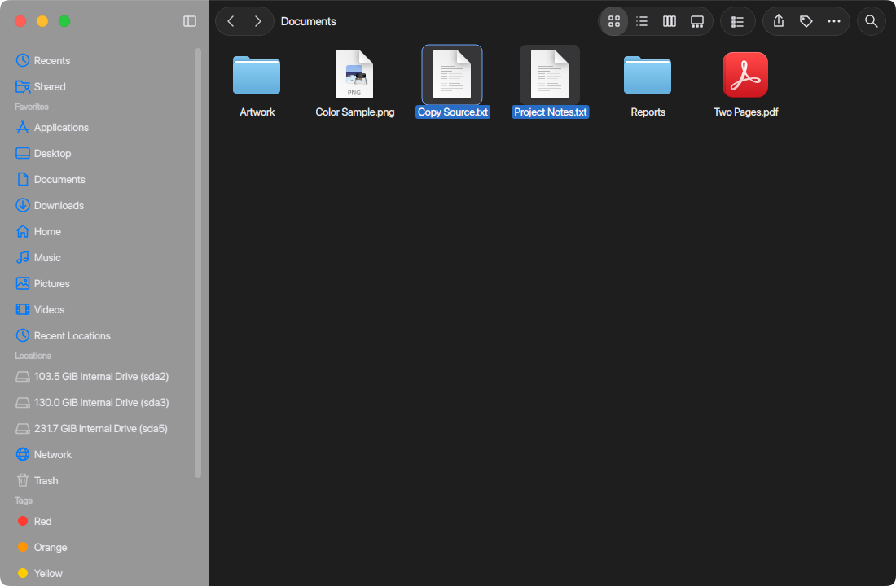
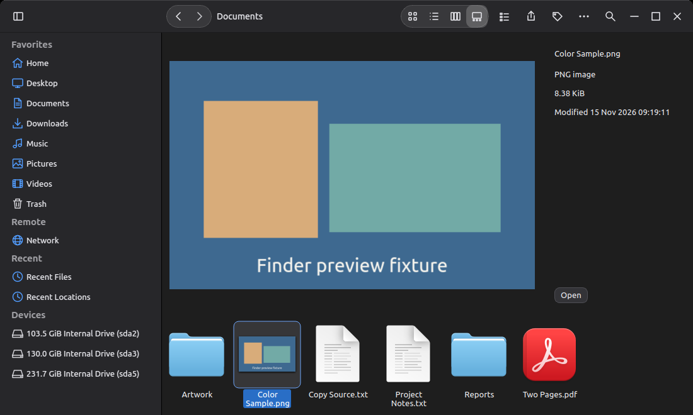

# macos-finder-linux

A native Qt 6/KDE file manager inspired by Finder, with Icons, List, real Miller
Columns, Gallery, multi-file Quick Look, local tags, saved Boolean searches,
and native KIO file operations.



This is a Linux approximation inspired by Apple Liquid Glass. It does not
contain Apple's Finder or renderer, and exact macOS pixel parity is not
established. The file pane is opaque; suitable chrome requests genuine KWin
compositor blur. The app now defaults to left traffic-light controls, 64px icons and an
already-installed SF Pro Display font, with Inter/sans-serif fallback. It does
not install fonts or change the desktop cursor.

Implemented features include tabs/history, inline rename, native conflict
handling, copy/move, Trash/Undo, file watching, device bookmarks/eject, saved
folder views, all six grouping choices, optional side previews, Gallery
Information/Show More, editable tag chips, image/PDF/text previews, and
explicit-play audio/video. Native ZIP creation and extraction use conflict handling,
cancellation and Undo. Icons support persistent manual positions, Snap to Grid,
Clean Up and spring-loaded folders. PDF previews support search, selection and
multipage scrolling; media can export a trimmed copy through installed FFmpeg.
Quick Actions provide image conversion/markup and image or rasterized PDF combination.

The v7 additions include Show All Tabs with cached cards for switching, closing,
creating and reordering tabs. New Folder creates an unused `Untitled Folder`
(or numbered sibling) and starts inline naming; creation and rename each have
native Undo. Multi-selection Rename opens a Qt BatchRename dialog with Replace
Text, Add Text and Format previews for up to 4,096 local files or folders.
Native KIO renames handle dependencies and cycles, with Undo for each successful
step, including temporary cycle names. Get Info hosts full Name & Extension,
per-file Show/Hide/Inherit extension choices and explicit comment saves inside
native `KPropertiesDialog`, alongside permissions and Open With. These metadata
fields use Linux extended attributes on supported storage.

Settings include a persistent tag registry and favorite slots, light/dark/system
appearance, increased contrast and reduced transparency. Inspector follows the
selection or pins its real metadata. Closed windows and explicitly saved sessions
can restore their tabs and views. Linux `user.xdg.tags` preserves custom tags.
Bounded local search supports names, dates, sizes, tags and Unicode text with
nested Any/All/None criteria. Optional Baloo queries use an existing index and
report its coverage; the app does not start an indexer. Search results support
all four presentations with shared selection, sorting and Gallery previews.



## Build and run

Requires Linux, Qt 6 and KDE Frameworks 6 development packages. See
[dependencies and build instructions](docs/build.md).

```sh
cmake -S . -B build -G Ninja -DCMAKE_BUILD_TYPE=Release
cmake --build build --parallel
ctest --test-dir build --output-on-failure
./build/finder
```

The native implementation passed **32 isolated Wayland integration checks**.
The sidebar also passed 22 boundary/geometry captures at both 1× and 1.5× scale, including
actual tag activation and native resize input. A compositor capture measured
real backdrop blur while the file pane stayed unchanged.
See [validation](docs/validation.md) and [design and platform limits](docs/design.md).

## Optional KDE desktop integration

On the originating Kubuntu/Plasma installation, the scoped installer replaces
existing Dolphin launch routes and the folder default, preserving an original
Dolphin launcher and backups. It expects KDE's `plasma-dolphin.service` and an
existing Dolphin desktop entry. Read [tools/install.py](tools/install.py) before
applying this desktop-specific integration.

```sh
python3 tools/test-install.py
python3 tools/install.py --prepare
python3 tools/install.py --apply /path/printed/by/prepare
python3 tools/install.py --verify
```

Existing file-manager windows must be closed for replacement. The prepared
manifest lists exact writes. Restore with `--restore /path/to/backup`; the last
successful backup path is recorded in `last-backup.txt`. The installer restarts
only the file-manager daemon. It does not restart Plasma, KWin or Spotlight.
CMake's ordinary install installs only the binary.

Space opens Quick Look; Return/F2 renames. Meta is the Linux Super/Windows key;
Alt supplies Option-style shortcuts.

| Action | Shortcuts |
| --- | --- |
| Icons / List / Columns / Gallery | Meta+1..4 or Alt+1..4 |
| Toggle favorite tag slots | Ctrl+1..7 |
| Clear all tags | Ctrl+0 |
| New tab | Meta+T or Ctrl+T |
| Find | Meta+F or Ctrl+F |
| Go to Folder | Meta+Shift+G or Ctrl+L |
| View Options | Meta+J or Ctrl+J |
| New Folder | Meta+Shift+N or Ctrl+Shift+N |
| Show/Hide Sidebar | Meta+Alt+S (also Meta+Ctrl+S) |
| Enclosing Folder in New Window | Meta+Ctrl+Up |
| Add selected folders to Sidebar | Meta+Ctrl+T |
| Slideshow (multiple selected files) | Meta+Alt+Y |
| Show All Tabs | Meta+Shift+\\ |

## License

Original application code is MIT licensed. Qt, KDE Frameworks and external icon
themes retain their own licenses. No Apple font, UI kit or proprietary image
bundle is included.
