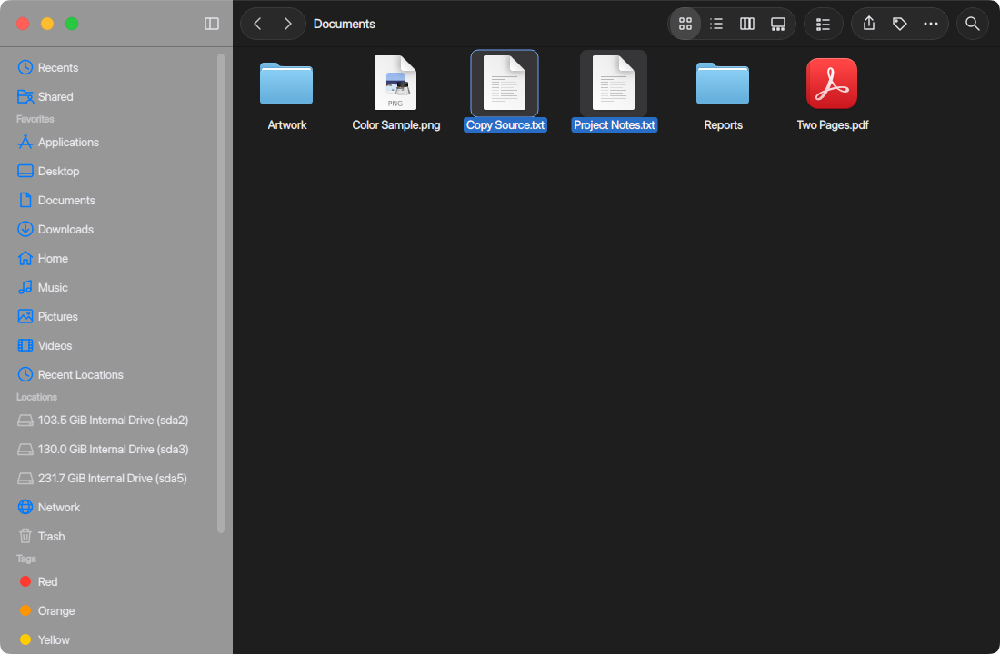
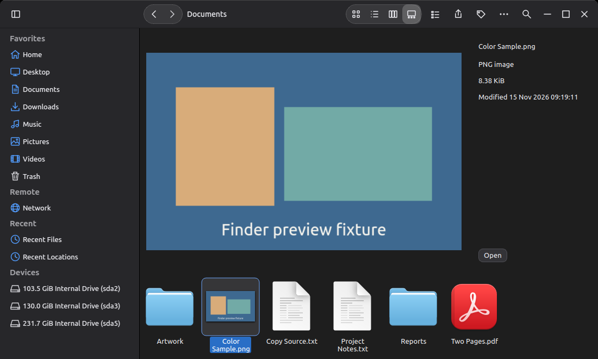

# Design and platform scope

Finder for Linux is a native Qt 6/KDE Frameworks file manager inspired by
Finder's organization and Apple Liquid Glass. It is an approximation on Linux.
It does not contain Apple's renderer, reproduce macOS services, or establish
literal pixel parity with any macOS release.

## Window and views

The client uses a unified 52 logical pixel toolbar and an initially 166 pixel,
resizable sidebar. Back/forward, the folder title, four view controls, sorting,
tags, actions and search share that toolbar. At narrow widths the view controls
collapse into a popup. The file pane stays opaque; glass is reserved for the
header and sidebar. A 16px continuous outer contour with a 60% smoothing transition is drawn locally. Its cached alpha mask and native blur/contrast region share the same geometry, including fractional application scale.

The sidebar and content adjoin without a reserved splitter strip. The native
resize handle overlaps the panes, retaining its grab area without exposing the
desktop between them. The content stack has an opaque base across both folder
and search pages. Navigation and four-view capsules measure 73×36 and 158×36
logical pixels respectively. The larger four-view width follows the later
user-supplied Finder screenshot rather than the generic window-kit size.

Icons, List, Columns and Gallery are separate native views. At the default
64px icon size, Icons uses a 111px horizontal pitch and middle-elides the
second filename line. List defaults to 16px icons, 20px rows and Name / Date
Modified / Size / Kind columns. Its rounded alternating stripes extend into
the blank viewport without creating file indexes; larger icons/text expand
the real rows. Saved folder choices remain authoritative. List exposes real
sortable metadata columns and expandable directories. Columns retains a real
folder hierarchy with keyboard navigation. Gallery combines a large preview,
a right information panel and a horizontal filmstrip. Icon and Gallery cells
use cached native file thumbnails, a neutral rounded icon selection and a blue
filename selection. A two-line filename and the inline rename editor occupy
the area below each icon.

The v7 Show All Tabs overview presents cached native widget thumbnails, tab
titles and location tooltips for up to 100 tabs. The overview switches, creates
or closes tabs through the existing window actions. Cards reorder the actual
tab bar by dragging or Alt+Left/Right. Return opens the selected tab; Delete/Backspace
closes it. Thumbnails refresh with overview/tab changes rather than continuously
capturing the compositor. Each tab retains its independent navigation and view
state; the overview is a portable Qt interaction, not a macOS window service.

These images are captures of this Linux implementation using disposable
fixtures, not Apple reference images. They use disposable files and hide filesystem breadcrumbs and status paths.

The app defaults to left traffic-light window controls with persistent symbols
and the user's selected 13px Ubuntu Medium font, with sans-serif fallback. It
installs no fonts and leaves global desktop font and cursor settings unchanged. Icons
default to 64px; path and status bars start hidden and can be enabled in View.
The chrome keeps native move, edge resize with cursor feedback, minimize, fill/restore and close behavior. Green click and keyboard activation enter/exit full screen; Option-click fills/restores, and right-click opens window layouts. Leaving full screen preserves prior maximization. Hidden toolbar mode retains a 40px title/control/menu row and independent sidebar. Activating a window preserves its layout.

## Material and native behavior

The sidebar and the header's sidebar segment request region-limited KWin blur
of the actual compositor backdrop. They use a restrained dark neutral tint,
reduced backdrop saturation and a readable solid fallback when blur is unavailable.
The sidebar frost uses dark RGB21/20/18 at alpha212 and light RGB242/242/245
at alpha232, with native backdrop saturation0.35/0.7 respectively. Its modest
transmission reveals broad blurred color while keeping navigation readable.
The content toolbar remains an opaque `#1e1e1e` surface in normal dark mode;
individual controls never expose holes into the unrelated desktop behind it.
Wallpaper is not substituted for windows behind the application. The coating approximates a glass appearance; genuine backdrop
refraction and Apple's proprietary material renderer are not implemented.
Foreground text, icons and file content remain crisp. Shared toolbar capsules
use an original directional coating, contour highlights and native button
hover, pressed, checked and keyboard-focus states. Capsules are neutral,
content-backed controls with restrained top/bottom bevel highlights; selected
dark controls use RGB45 and navigation glyphs have a dedicated saturated blue
separate from readable link colors. They do not capture
wallpaper or add continuous sampling.
High contrast and reduced transparency use readable opaque fills. These
controls do not implement refraction or Apple's material interaction physics.

KDirModel, KIO, KFilePlacesModel and KFilePlacesView retain native filesystem
watching, bookmarks, storage locations, context menus, keyboard navigation,
thumbnails, transfers, conflict handling, Trash and Undo. A separate QTreeView
presents true 32px sidebar rows and 32px nonselectable heading areas, while
KFilePlacesModel and the original view retain bookmark/device menus, native
mount/eject and deferred file drops. Recents and Shared precede Favorites;
Locations and seven tag colors follow. Tag selection searches actual local
metadata under the home folder, including hidden folders, with the current folder scanned first within the
same search budgets below. Linux routes use the available KIO workers. Material rendering is
separate from these actions. Tabs and history keep independent folder state;
folder settings retain view, sorting, grouping, spacing, label position, preview
visibility, icon size and List column visibility. Six grouping choices operate
on real file indexes: None, Name, Kind, Date Modified, Size and Tags. A file
with several tags appears once under its complete tag set. This differs from
Finder grouping that can repeat an item in separate tag categories.

Quick Look uses bounded, cached native image and PDF rendering. PDF pages are
composited on white paper, text previews are read-only and limited to 512 KiB
with horizontal scrolling, and audio/video begins only after Play. Unsupported
or remote formats offer metadata and their normal default-application route.
Gallery adds compact Information, Show More, a thumbnail/name/kind-size header,
editable standard/custom tags, Open/Get Info and More actions. Rotate Left as
Copy exports a bounded original-resolution PNG through KIO, choosing an unused
name and recording native Undo; it does not overwrite the original. Compress
creates ZIP files natively; opening a local ZIP expands it beside the archive.
Staging completes before native KIO publication, with naming, conflicts,
cancellation and Undo. Email sharing uses the installed xdg-email route.

Recursive filename search runs on a worker and ignores obsolete requests after
cancellation. Its defaults are 2,000 results, 250,000 entries and 15 seconds;
the UI reports a reached limit. Hidden entries are optional. Symlink recursion,
virtual mounts and remote search roots are excluded. Search actions operate on
the visible result selection. Nested All/Any/None conditions combine real name,
kind, size, modified/created date, tag and bounded Unicode text predicates.
Smart Folder JSON descriptors preserve those conditions. Existing Baloo indexes
can supply content candidates; index coverage, exclusions and stale entries
remain provider limitations, and the UI reports them. This Computer uses an
existing index rather than starting a recursive disk scan.

Colored and custom tags use KDE-compatible Linux `user.xdg.tags` metadata.
Changes preserve custom tags and unrelated metadata. Metadata writes are
serialized; pending reads disable stale tag menu state. Unsupported storage,
symlinks and permission failures produce errors rather than a hidden tag
database.

The user-level installer scopes changes to the file-manager routes, desktop
entries, FileManager1 activation and folder MIME preference. It retains a
Dolphin fallback launcher and journals backups/restore. It does not replace a
manager with open windows or restart Plasma, KWin or Spotlight.

## References and limitations

Geometry and hierarchy were reviewed against Apple's public
[Design Resources](https://developer.apple.com/design/resources/) and the
[Finder views](https://support.apple.com/guide/mac-help/change-folders-displayed-finder-mac-mchldaafb302/mac),
[toolbar](https://support.apple.com/guide/mac-help/customize-the-finder-toolbar-on-mac-mchlp3011/mac),
and [Quick Look](https://support.apple.com/guide/mac-help/preview-a-file-mh14119/mac)
guides. Generic window-kit dimensions do not establish every Finder default.
The macOS 27 design resources were reviewed during development in November
2026; proprietary kit files are not distributed in this repository.

Linux material design also consulted
[Liquid Glass KDE Widgets](https://github.com/jaxparrow07/liquidglass-kde-widgets)
and [liquid_glass_widgets](https://github.com/sdegenaar/liquid_glass_widgets).
The additional user-selected
[macos-tahoe-liquid-kde](https://github.com/lestercorderomurillo/macos-tahoe-liquid-kde)
provided a concrete Acrylic Glass compositor-source reference for actual
backdrop sampling, edge-gated refraction and separate component presets.
No code, upstream installer or theme assets were imported from that project.
Their platform shaders and rendering APIs are references, not compatible Qt
assets or evidence of equality with current macOS.

iCloud, AirDrop, macOS sharing services, Finder extensions, the complete Quick
Actions catalog and every Finder preview format are not implemented. Search results share exact URL selection and sorting across Icons, List, flat
Columns with real Location details, and Gallery with a decoded preview. Search
Columns does not manufacture a directory hierarchy from unrelated hits. Native remote
directory support depends on installed KIO workers, and blur depends on KWin.
No lossless comparison with identical files, geometry, scale, typography and
backdrop has established pixel parity.

A component comparison on 2026-11-15 confirmed the then-current 52-pixel toolbar,
256-pixel initial sidebar, content origin at (256, 52), the capsule dimensions
above, 32-pixel medium sidebar rows, and `#1e1e1e` opaque dark content. These
matches concern generic kit primitives. The sidebar presentation now uses
32px rows. The later user-supplied Finder screenshots guided the narrower
166px sidebar, 111px icon pitch, compact List rows and heading spacing.
Material, typography fallback
and platform differences remain. This comparison does not establish whole-window 1:1 Finder equality.

This repository does not bundle Apple fonts, Apple kit images or proprietary
icon assets. Qt/KDE dependencies and any separately installed icon theme retain
their own licenses and authorship. The screenshots show an existing desktop
icon theme; the theme itself is not included.

## Portable interaction additions

New Folder creates a real `Untitled Folder`, choosing a numbered sibling when
the name is occupied and retrying native creation conflicts. Once the native
listing contains the new folder, the active view selects it and starts inline
naming. Escape leaves the created folder with its current name. KIO records
creation and any subsequent rename separately, so file Undo reverses the rename
before removing the created folder. Navigating away prevents the delayed editor
from targeting another location.

Multi-selection Rename uses the application's Qt Widgets `BatchRenameDialog`. Replace Text
operates case-sensitively on full filenames, including hidden extensions, and
honors the extension-change warning setting. Add Text inserts before or after
the stem; Format offers Name and Index, Name and Counter, or Name and Date with
a custom name and starting number. Add/Format preserve compound extensions and
unknown final suffixes, treating single-component dotfiles as extensionless.
Preview uses the captured selection order and full old/new filenames; later
selection or navigation cannot retarget it.
Date spelling and separators are a Linux approximation.

Batch rename accepts at most 4,096 local files or folders, keeps each item in
its original parent and rejects a selected folder together with its descendants.
Asynchronous KIO checks reject duplicate targets, existing unselected targets
and sources that would require cross-filesystem copying. Dependency chains are
ordered to free target names; each cycle uses one temporary sibling name. Every
successful KIO rename, including temporary moves, has native per-step Undo;
the batch is not an atomic transaction. Cancel finishes the current dependency
group before stopping. Errors or native conflict cancellation can leave partial
results or a temporary name, with actual resulting URLs reported and successful
steps still undoable. Native conflict handling supports alternate names, Skip
for independent items and Cancel; overwrite/merge is unavailable. Remote batch
rename is excluded because the supported KIO API can fall back to copying.

Single-file Get Info embeds the Name & Comments editor in native
`KPropertiesDialog`, retaining General, permissions and Open With. Name &
Extension always shows the real full filename and delegates renames to native
KIO conflict handling and Undo. The Hide extension checkbox stores explicit
Hide or Show; Use default restores Inherit. Inherit follows the existing
known-suffix presentation, Hide can also hide an unknown final suffix, and the
global Show All Extensions preference overrides either choice. Directory names
remain complete. All four Browser views share this presentation without
changing file URLs or names.

Extension overrides use Linux `user.finder.hide_extension` (`1` for Hide, `0`
for Show, absent for Inherit); comments use KDE-compatible `user.xdg.comment`.
Save Comment explicitly writes valid UTF-8 up to 16 KiB; clearing it removes the
attribute. These are inode attributes, not macOS Finder flags or a private
database. They preserve file contents, tags and unrelated attributes; filesystem
ctime may change. Reads/writes use pinned, verified local regular files or
directories and reject symlinks and special files. Asynchronous metadata reads
are bounded to 4,096 entries and a cooperative five-second budget, with cached
results refreshed by listing/metadata changes rather than polling. The read
budget is cooperative between filesystem calls; blocked kernel/network calls
can exceed it. Conservative read-only reopening can make metadata unavailable
for unreadable files. Unsupported
storage, permissions, malformed values and stale inode identities produce
visible errors. Metadata saves are explicit and are separate from file Undo.
Get Info and its
Finder owner refuse closure/Quit while an admitted save or custom rename is
pending, without waiting on the GUI thread. Embedded Escape reaches the native
host. Hidden-page saves still refresh their cache; retargeted results cannot
replace another file's fields. A custom rename requires saved comment/native
property drafts, then rebuilds General/type/Open With from fresh native data.
If reload fails, the old properties window closes and Finder reports the error.
Search batch preflight admits one request per window, with four active stat
jobs at most; navigation or changed criteria cancels it.

Icons can save positions by file URL, return to them after sorting/grouping,
snap to a grid and clean up by real metadata. Spring loading navigates temporary
hovered folders and rolls back on Escape or drag cancellation; history and
folder preferences change only after a committed drop. Pixel/momentum scroll
input remains native; wheel easing is interruptible with reduced motion. No
measurement establishes Apple's exact scroll physics.

Mouse-wheel distance uses the system wheel-line count multiplied by a capped
24px view step and the app's speed percentage (50% by default). Large Icons and
Gallery tiles therefore cannot multiply one notch into several tile heights.
Settings → Advanced exposes Mouse wheel speed (10–200%). Turning smooth
scrolling off removes easing while retaining the same distance. Angle-only
phased input uses this bounded distance directly; precise touchpad pixels and
their momentum remain 1:1, without an added animation tail. Keyboard paging,
scrollbar actions and drag autoscroll keep their native Qt behavior.

Quick Look adds PDF page navigation, bounded search/text selection and lazy
multipage scrolling. Image actions operate at original resolution; image/PDF
combination is a raster fallback, not structural PDF editing. FFmpeg trim
exports same-container copies with validated duration, original bytes preserved,
KIO conflicts and Undo. Installed encoders determine media support.

Inspector follows the actual selection or pins it, displays asynchronous
metadata for up to 4,096 entries and exposes native properties/reveal actions.
It does not recurse through folder contents or substitute filesystem ctime for
a missing creation date. Closed windows and explicit previous-session restoration
preserve tabs, history, selection and view options within bounded records.

Appearance defaults to dark and adds light/system modes, increased contrast and
reduced transparency. The latter two use opaque material and disable native blur.
Semantic palettes leave the chosen font and global desktop settings unchanged.

OCR, structural PDF markup, background removal, Apple cloud/sharing services
and proprietary Finder extension providers are still absent. Platform limitations
and tested portable behavior do not establish literal 1:1 Finder parity.

## Touch and ordinary input

Native two-finger pinch zooms file icons and image/PDF previews through the existing bounded size/zoom APIs. Touchscreen dragging pans noninteractive preview details through QScroller, with cancellation and reduced motion. Item views retain native tap selection and file drag/drop; pixel/momentum wheel scrolling keeps its existing direct input path. No idle gesture polling is added. Qt Wayland exposes pinch but does not expose normal two-finger scrolling as a native Swipe, so two-finger history cannot be promised on that backend. A genuine native Swipe from a supported backend invokes the enabled history action. Physical-device feel is unverified.

Text-focused Copy/Cut/Paste/Select All/Undo use the actual editor, including menu and Meta paths; text Undo cannot invoke a file Undo. File context menus share selection, Trash and destination policy with File/More actions. Search/tab transfers focus the displayed content; Settings retains the most recently activated Finder owner. Folder entry points use one policy, and Option-open closes its source window only after the destination's native listing succeeds.

Get Info from the File menu, Quick Look and Inspector uses the same guarded
native-properties host with Name & Comments, per-file extension settings and
native permissions/Open With. Metadata save and custom rename completion keep
the host alive. External FileManager1 properties requests and multi-item Summary
Info retain the native KDE properties presentation.

KDE Rounded Corners can add a second outline over this client contour. On that compositor, `python3 tools/fix-kwin-outline.py --apply` appends only `org.local.finder` to `Round-Corners/Exclusions`, preserving other entries and recording a backup. The helper recreates only the loaded Rounded Corners effect so existing windows refresh its cached exclusions. It preserves the three Breeze keys that the upstream effect writes during reload; KWin keeps running. Other applications retain their desktop corner settings.

Quick Look uses one 40px host header containing traffic lights, the active
filename, Open and Actions. Its content surface is explicitly opaque; the
window contour clips both header and content. Initial size is bounded by the
available screen. Zoom, contact sheet, slideshow, fullscreen and optional
information remain available in Actions instead of a second bottom toolbar.
PDF navigation/search and media playback controls remain inline.

## Recents identity and feedback

Virtual KIO listings retain their source URLs for model indexing, sorting and
selection. Operations, Quick Look and Get Info use the provider's explicit
`KFileItem::targetUrl()`. Adapted items are reconstructed from the provider's
UDSEntry so their native locality flags and filename agree with the target.
Both native URL MIME flavors contain operation targets. Columns selections
in a virtual listing do not replace its navigation history with a synthetic
file address; activating a virtual folder opens its real target.

Directory overlays distinguish loading, an empty folder, hidden-only content,
no filter matches, empty Recents/Trash and a failed listing. They are original
vector/text QWidget layers with accessible names and descriptions. Mouse
input passes through to native views; empty child Columns are handled in the
preview surface that Qt uses for leaf directories. State updates use listing,
selection and viewport events. Child teardown disconnects callbacks before
Browser private state is destroyed.

`FinderJobUiDelegate` subclasses the public KIO widgets delegate and changes
error presentation while retaining native authentication/conflict interfaces.
Missing-item Open errors identify the actual filename and retain native details.
Controllers that already report errors to the host disable automatic error
presentation to avoid duplicate alerts. Cancelled jobs do not create alerts.
Long diagnostics move into scrollable details with a bounded summary. The
rounded alert is an opaque fallback inspired by the audited generic Apple
alert hierarchy, adapted to 320 logical pixels for real error text. It does
not implement Apple's renderer or exact macOS error codes/layouts.

Traffic lights use original vector gradients, rim/glint painting and persistent
symbols, with disabled/inactive, pressed, focus and high-contrast variants.
Their existing 20×28 hitboxes and native window actions are preserved. Gloss
requires neither backdrop capture nor an animation timer. Main Finder and
hosted Quick Look share the same controls. Native conflict, authentication and
properties layouts remain KDE dialogs.

### Finder and standalone Preview controls

Finder’s sorting menu now limits None/Snap/Clean Up to Icons; Clean Up requires
an ungrouped manual layout. Date Added and Last Opened remain disabled because
there is no authoritative provider. Filesystem access time is named Accessed.
View Options applies changes immediately, presents controls by mode, and offers
Use as Defaults without closing. Search has its own presentation options.
Gallery supports hiding filenames. Preview Options controls Information, dates,
image/page geometry, location and Quick Actions. Settings retains four sections,
with compact favorite slots and grouped Favorites/Locations/Advanced controls.

Image Actual Size displays one original pixel per logical screen point using the
bounded decoded raster. Enlargement preserves source geometry, with limited
preview detail; it never triggers an unbounded full-resolution decode. Fit and
zoom remain available. Plain text previews wrap by default, with an unwrapped
option. No untrusted rich HTML is executed.

`finder --preview -- <URLs>` starts a separate Preview window without claiming
Finder’s desktop service. It reuses image/PDF/text viewing, PDF selection/search,
printing, native image editing/export, PDF creation, native conflicts and Undo.
The document sidebar loads visible native thumbnails in eight-item batches,
retains up to 64 nearby decoded thumbnails and stops when idle. Thumbnails sit
above middle-elided filenames with full-path tooltips, and the borderless native
sidebar handle is shared with Finder. Menus support
Open/Recent, view controls, text Find and a separate Settings panel. Source files
remain unchanged during edits and export. The existing continuous contour and
traffic lights are shared with Finder. This is a Linux approximation inspired by
Finder and Preview, not an implementation of Apple’s renderer or platform APIs.

The scoped Preview installer changes only its launcher, desktop entry and seven
image/PDF defaults, with backups and rollback. Office formats and text editing
retain their existing native handlers. Other image formats remain with installed
viewers. OCR, structural PDF editing/markup, Apple signatures, HDR parity and
Live Photos remain unavailable; codec/thumbnail availability determines format
coverage. Five-second metadata budgets and decoder cancellation remain
cooperative between native calls.

### Current standalone document hierarchy

The standalone viewer now uses a dedicated document presentation rather than
Quick Look’s Open/Actions header. Apple’s current macOS 27 Preview guide and
image/PDF screenshots are the visual reference; older community screenshots
are used only for feature/code comparison. A leading document title displays
current page or image scale, with shared grouped icon zoom/document controls.
PDF search opens on demand. Single images hide thumbnails automatically unless
an explicit Viewer/showThumbnails setting exists; PDFs and document collections
show the sidebar by default. Thumbnails follow sidebar width and preserve aspect.

Application menus export to Plasma and stay accessible from a persistent local
menu button and F10. Narrow windows move document tools into that menu. Get Info
opens native properties, rotation/markup/export use source-preserving QuickActions,
and Share offers actual copy/email choices. The selected font/cursor and right-side
visible window controls remain user preferences. This is a Linux approximation;
PDF signatures/editing/OCR and Apple renderer/platform services remain unavailable.

### Configurable window controls and sidebar translucency

Finder Settings → General offers Glossy/Flat, Left/Right and Always visible/On
hover window-control choices. Preview Settings exposes the same application-wide
preferences. Cached keys are Appearance/windowControlsStyle (glossy default),
windowControlsSide (right), windowControlsSymbols (always), and
sidebarTranslucency (0–40 percent backdrop contribution). Invalid enums fall back
to defaults. Missing translucency retains dark/light 17/9 percent transmission.
Changes update existing Finder, Quick Look and Preview windows. Shared control
instances and their native action/menu connections survive side changes.

Standard traffic lights have 14-pixel circles and 23-pixel center spacing, with
20×28 input targets. Current audited Apple standard-window colors inform the
original vector drawing; the glossy finish is a restrained adaptation, not a
claim of Apple's renderer or pixel equality. Hover mode reveals symbols for the
entire group; keyboard focus and high contrast retain visible identification.
Mouse clicks do not show the keyboard focus ring. Tab/Backtab/shortcut focus
retains it, while text fields retain their editing focus indication.

Finder and Preview use one alpha/scale-aware contour cache for region-limited
native KWin blur. Translucency updates the sidebar and its header region; the
file/document canvas stays opaque. Without compositor blur the coating is solid.
Reduce Transparency and Increase Contrast override to opaque while preserving
the stored slider value. Navigation text/glyph colors adapt to stronger
transmission. There is no wallpaper substitution, new capture loop or idle timer. A native
file/directory watcher follows atomic settings replacements so separate Preview
processes update too. Native button style suppresses mouse-origin focus frames
while retaining Tab/Backtab/shortcut focus and ordinary pressed/checked feedback.

### Compact sidebar, list stripes and popup presentation

General Settings exposes View/alternatingRowColors (true by default). It controls
native List alternation and the decorative continuation below files, including
search List presentation; changing it does not reset selection or the model.
Sidebar Settings exposes Sidebar/itemSize=small|medium|large. The default small
preset uses 24px rows/16px glyphs, with 32/20 and 40/24 alternatives from the current
audited standard sidebar presets. Section headings have compact spacing and
empty sections are removed after visibility filtering. Right-side traffic lights
leave a functional sidebar toggle in the leading header.

The Actions popup starts with Settings and frequent context commands. Unavailable
context actions are hidden only on their forwarding entries, keeping application
menu actions independently visible. Full application categories stay under
Application Menus and the F10 route, with a persistent fallback when the toolbar
is hidden. Native shortcuts and operations remain on their original actions.

The application-wide popup presentation gives menus compact rounded rows and
actual alpha contours, and gives Qt/KDE dialogs a shared rounded titlebar,
caption/control placement and consistent content controls. Original dialog
layouts, ownership, default actions, rejection/close guards and modal behavior
remain. The wrapper does not replace native file/conflict/authentication
providers or claim it styles windows in external portal processes. Colors follow
light/dark/high contrast; keyboard focus remains. Popup fallback is opaque and
uses no wallpaper substitution, backdrop capture loop or claimed refraction.

### Gallery entry and truthful inspectors

Gallery selects the first sorted native directory item on folder or mode entry
when there is no explicit target to restore. Existing selection and primary
identity survive mode changes and native KDirLister relisting; missing targets
are released when listing completes. Explicit deselection in the current
Gallery session remains cleared. Selection continues to use native indexes,
keyboard navigation, drag/drop and file-operation providers.

A cleared or empty Gallery hides its file-information sidebar, thumbnail and
disabled actions until a real target exists. Selected image/document/folder
identity is displayed with actual metadata. Empty folders show one opaque
full-size directory state, without repeating it in the filmstrip or displaying
the underlying selection prompt. These choices address demonstrated empty-panel
UX; exact macOS initial-selection rules are not established.

Dark navigation frost uses a lighter neutral #252528 coating at the default
17% backdrop contribution, with brighter headings. Above 25% transmission, the
coating deepens gradually and glyph/text tokens adapt to retain readability
over bright backdrop extremes. User translucency, location visibility, density
and width remain intact. Existing region-limited native blur remains; this is
a Linux approximation inspired by Finder and Apple Liquid Glass, without a
new capture loop, Apple renderer or measured pixel-equivalence claim.
